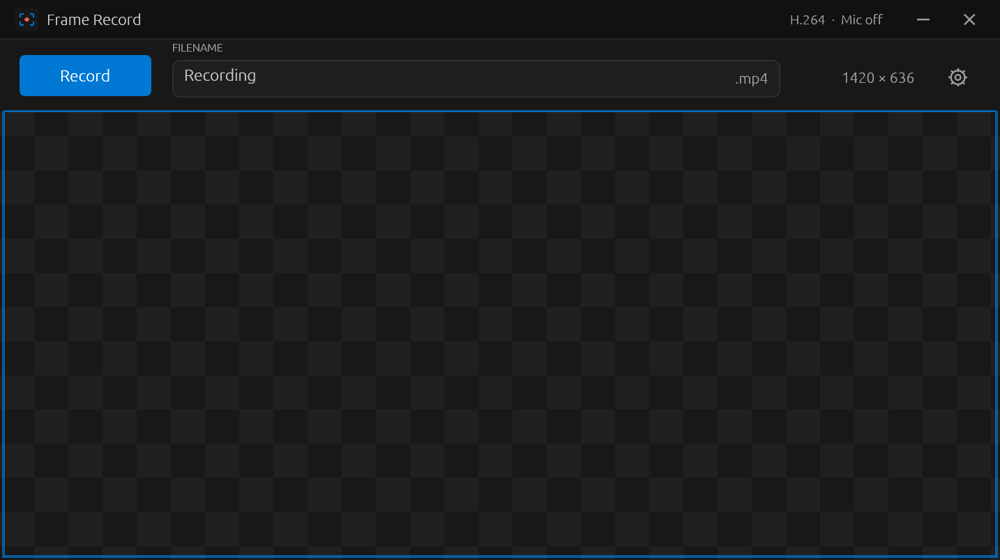

# Frame Record

A simple screen recorder for Windows, written in Rust. It has two front ends:

- **`frame-record.exe`**: a transparent frame you place over what you want to record. Click **Record**, then **Stop**.
- **`frame-record-cli.exe`**: a command-line recorder for scripts and AI agents. One command records a screen, a window or a rectangle. It prints one line: the path of the saved file.



## Use the frame

1. Open `frame-record.exe`.
2. Drag the title bar to move the frame. Drag an edge or corner to resize it.
3. Enter a filename in the top bar.
4. Click **Record**, then **Stop**.

Recordings are saved as MP4 files in your Windows **Videos** folder. Existing names get a number: `Recording.mp4`, `Recording (1).mp4`, `Recording (2).mp4`.

The center is fully transparent and lets you use the app underneath. Only the area inside the border is recorded. The toolbar and border stay out of the video. The frame stays fixed while recording.

Settings:

- **Codec:** H.264 or H.265.
- **Frame rate:** defaults to 60 FPS.
- **Compression:** lower for better quality, higher for smaller files.
- **Microphone:** optional; off by default. While recording, a level meter beside **Mic on** in the title bar shows when the microphone hears you.

Your settings are remembered.

## Use the command line (for scripts and AI agents)

`frame-record-cli.exe` sits beside `frame-record.exe` and uses the same FFmpeg.

```text
frame-record-cli record [TARGET] [OPTIONS]  record until -t elapses, Ctrl+C, or `stop`; prints the file path
frame-record-cli start [TARGET] [OPTIONS]   record in the background; prints the file path once capturing
frame-record-cli stop                       finish the running recording; prints the file path
frame-record-cli windows                    list visible windows: X,Y,W,H title
frame-record-cli screens                    list screens: N X,Y,W,H [primary]
frame-record-cli mics                       list microphone names

TARGET (default: --screen 0, the primary screen)
  --region X,Y,W,H    a rectangle in physical pixels (may be negative on multi-monitor desktops)
  --window TITLE      first visible window whose title contains TITLE (case-insensitive)
  --screen N          a screen index from `screens`

OPTIONS
  -t, --seconds S     stop after S seconds (decimals allowed)
  -o, --output P      file path, or a folder ending in \ (default: Videos\Recording <date time>.mp4)
  --fps N             frames per second, 1-240 (default 60)
  --crf N             quality, 0-51, lower is better (default 23)
  --codec h264|h265   default h264
  --mic [NAME]        record the first microphone, or the first whose name contains NAME
```

How it behaves:

- **Output:**
  - On success, stdout gets only the absolute path of the MP4, or the list for `windows`, `screens` and `mics`.
  - On failure, stderr gets one `error: ...` line. Exit codes: 0 success, 1 failure, 2 bad arguments (help is printed too).
- **Existing files:** they are never overwritten. A taken name gets a number: `clip.mp4`, `clip (1).mp4`.
- **Capture area:**
  - The area is clipped to the desktop, and its width and height are rounded down to even numbers.
  - A window target is brought to the front first, when Windows allows it. The capture is a fixed screen area, so anything covering it is recorded too.
- **Background recordings:**
  - Only one recording runs at a time.
  - `start` returns once FFmpeg is capturing. The recorder keeps running after the calling shell exits.
  - `stop` waits until the file is finished.
  - `start ... -t S` stops by itself after S seconds.
- **Microphone:** names come from `mics`.

Examples:

```powershell
# Record the primary screen for 5 seconds into the Videos folder.
frame-record-cli record -t 5

# Find a window, then record just that window for 10 seconds into a folder.
frame-record-cli windows
frame-record-cli record --window "Notepad" -t 10 -o C:\clips\

# Record a rectangle in the background while doing other work, then stop.
frame-record-cli start --region 0,0,1280,720 --fps 30 -o C:\clips\demo.mp4
# ... interact with the screen ...
frame-record-cli stop
```

In PowerShell, `--region 0,0,1280,720` also works unquoted.

## Install a release

1. Download `frame-record-v<version>-windows-x64.zip` from [Releases](https://github.com/bhowiebkr/frame-record/releases).
2. Extract it. It contains `frame-record.exe`, `frame-record-cli.exe` and `ffmpeg.exe`.

The apps are not code-signed, so Windows SmartScreen may ask you to confirm the first launch of `frame-record.exe`.

## Build from source

Requirements:

- 64-bit Windows 10 or 11.
- Rust stable with the MSVC toolchain (`rustup default stable-x86_64-pc-windows-msvc`). It is tested with Rust 1.94.
- Visual Studio Build Tools with the **Desktop development with C++** workload.

Steps, run from the repository root in PowerShell:

```powershell
# 1. Download portable FFmpeg into tools\ffmpeg (needed to record; about 200 MB unpacked; git-ignored).
.\scripts\setup-ffmpeg.ps1

# 2. Build both executables into target\release.
cargo build --release --locked

# 3. Or build and assemble a runnable folder: dist\Frame Record (add -Package for the release ZIP).
.\scripts\build.ps1 -WithFFmpeg
.\scripts\build.ps1 -WithFFmpeg -Package
```

FFmpeg is found in this order:

1. The `FRAME_RECORD_FFMPEG` environment variable (full path to `ffmpeg.exe`).
2. Beside the executable: `ffmpeg.exe`, `bin\ffmpeg.exe` or `tools\ffmpeg\bin\ffmpeg.exe`.
3. In debug builds only, the repository's `tools\ffmpeg\bin`.
4. `PATH`.

Development commands:

```powershell
cargo test                                   # unit tests, no screen or FFmpeg needed
cargo clippy --all-targets -- -D warnings    # lint
cargo fmt --check                            # formatting
cargo run                                    # open the frame (debug build)
cargo run --bin frame-record-cli -- windows  # run the CLI (debug build)
cargo run -- --smoke-test                    # live end-to-end check (see below)
```

The smoke test drives the real app on your desktop:

- It records H.264, H.265 and microphone clips, then validates them with `ffprobe`.
- It writes into `test-output\Recording <date time>\`.
- It needs FFmpeg from step 1, and it exists only in debug builds.

Layout:

| Path | Contents |
| --- | --- |
| `src/lib.rs` | Shared library: `recorder` (FFmpeg arguments, process, files) and `native` (Win32 frame window, folders, job object) |
| `src/main.rs` | The frame app (egui), plus `source.rs` and the debug-only `smoke.rs` and `screenshot.rs` |
| `src/bin/frame-record-cli.rs` | The command-line recorder |
| `build.rs` | Embeds the icon and a ZIP of the source into the app |
| `scripts/` | `setup-ffmpeg.ps1`, `build.ps1` and the icon generator |

## Get the source

In the app, open **Settings → Save source code…** to export the small source ZIP embedded in the tool. It contains the matching source, assets, and build scripts for that version.

## License

[MIT](LICENSE). FFmpeg has its own license; see [third-party notices](THIRD-PARTY.md).
